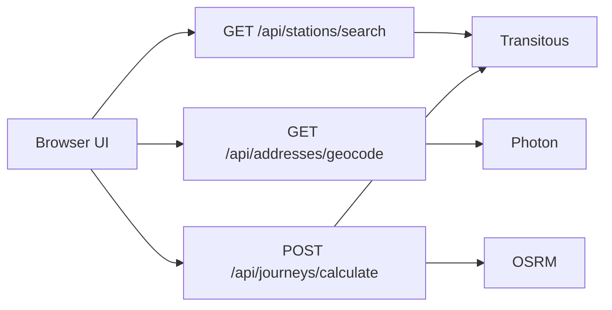

# Architecture

## Request flow

The browser UI is the React app in `client/`; it never calls providers directly, only the `/api` routes (`client/src/lib/api-client.ts`). Pages Functions under `functions/api/` validate HTTP input and delegate to services in `src/services/`. Provider adapters in `src/clients/` isolate Transitous, OSRM, and Photon formats. The transit contract is `TransitClient` (`src/clients/transit.client.ts`), implemented by `HttpTransitousClient`. The frontend renders loading, no-route, partial-result, stale, delay, and validation-failure states; preserve entered values whenever a request fails.

The UI geocodes home and work addresses once when settings are saved (re-geocoding only changed addresses) and stores the coordinates with the profile. Each dashboard load posts the profile to `/api/journeys/calculate` with `results: 5`; every returned option becomes one journey card.

The dashboards come in three views (`client/src/hooks/use-active-view.ts`): the classic cards, Glance (a one-handed countdown, opt-in) and Planner (opt-in, only from 1024 px wide). Planner (`client/src/pages/dashboard-plan.tsx`, logic in `client/src/lib/plan.ts`) loads 12 options per request and shows as many as fit on screen without scrolling (`useFittingRows` measures the rendered rows and keeps clear of the bottom navigation), lists every alternative once (`uniqueConnections`; same departure sorts by earlier arrival, then fewer transfers) for an explicit anchor built from a Europe/Berlin date and time, draws each option as a door-to-door timeline on a shared axis (full window width, labels every 30 min with 10-minute minor ticks; each train shows its line and track in the bar, its departure time and delay above it; with both modes the walk lane sits above the bike lane), for "now" shows only connections still reachable on foot or by bike (by hurrying, too) plus the most recently missed one, paging further until the list is full (`fetchPlanJourneys`, `selectNowRows`; the classic view and Glance use the same "now" request, the classic view the same selection for the modes set in the profile), flags tight transfers (under 5 min, at risk at 1 min or less) and pages with Earlier/Later by re-anchoring: later departs one minute after the last train, earlier arrives one minute before the first. Its long-distance switch writes `excludeFernverkehr` to the saved profile.

`/` is a standalone page that explains the app and leads to `/settings`; the installed web app starts at `/towork`. Routes name the direction, not the view: `/towork`, `/tohome` and `/settings` ( the pre-0.1.1 paths `/andback` and `/how` redirect, in `client/public/_redirects` and in the client router). Which view a direction shows is the profile setting plus the screen width, so a shared or bookmarked link works on any device.

### API contracts

| Endpoint | Input | Result |
| --- | --- | --- |
| `GET /api/stations/search` | `query` (2–100 chars), optional `limit` (1–20; default 5) | Transitous stop matches (IDs such as `de-DELFI_de:03241:31`). |
| `GET /api/addresses/geocode` | non-empty `q`, optional `limit` (1–10; default 5) | Photon address candidates and coordinates. |
| `POST /api/journeys/calculate` | home/work station IDs, home/work coordinates (a side's may be left out when both of its ways are fixed), `direction` (`work` or `home`), `departureTime` and/or `arrivalTime` (ISO; departure wins when both are sent), optional per-side minute buffers, optional `fixedDurations`, optional `results` (1–12, default 1), optional `excludeLongDistance` | `options[]` (one canonical journey per connection, plus `lineName`, `transfers` and `legs[]` with line, departure/arrival times, delays, tracks and stop names) and `calculatedJourneys` holding the first option. |

All endpoints use `{ "success": true, "data": ... }` on success and `{ "success": false, "error": { "code", "message", "details" } }` on failure. Validate external data before presenting it; a missing canonical field is an upstream-bad-response error, not an invitation to invent an alias.

## Journey model and contracts

The fixed journey is `A → B → C → D`:

- `A`: `homeAddress`; `B`: `homeStation`; `C`: `workStation`; `D`: `workAddress`.
- `x` is the home address/station route, `y` is station-to-station public transport, and `z` is the work station/address route.
- `journeyWork` travels A→D; `journeyHome` travels D→A. Segment `y` is named `transportWork` or `transportHome` to match direction.
- `homeStationTime` and `workStationTime` are immutable station-time anchors. `routeHomeWalkSec`, `routeHomeBikeSec`, `routeWorkWalkSec`, and `routeWorkBikeSec` are durations in seconds.
- Buffers enter as non-negative minutes, which may carry seconds as a fraction (`0.75` = 45 s), and are converted to whole seconds. Each side has its own: `bufferLeaveHome`/`bufferLeaveWork` (inside the building; walking and cycling), `bufferBikeHome`/`bufferBikeWork` (getting the bike out or putting it away; cycling only) and `bufferBikeParkingHome`/`bufferBikeParkingWork` (bike parking ↔ platform; cycling only). No buffer is shared between the sides.
- Optional `fixedDurations` (`homeWalkSec`, `homeBikeSec`, `workWalkSec`, `workBikeSec`; whole seconds up to 3 h) replace the route and all buffers of that side and mode. OSRM is not asked for a fixed way, and the journey carries `fixedHomeWalkSec` etc. with the matching `route*Sec` set to the same value. A side whose walk and bike times are both fixed needs no address in the request.
- The canonical outputs are `homeAddressWalkTime`, `homeAddressBikeTime`, `workAddressWalkTime`, and `workAddressBikeTime`, all ISO 8601 timestamps.

The way of a side is the same in both directions, so its buffers apply both when leaving towards the station and when arriving from it:

- home walk = `fixedHomeWalkSec` or `routeHomeWalkSec + bufferLeaveHomeSec`
- home bike = `fixedHomeBikeSec` or `routeHomeBikeSec + bufferLeaveHomeSec + bufferBikeHomeSec + bufferBikeParkingHomeSec`
- the work side likewise with its own fields.

For `journeyWork`, subtract the home way from `homeStationTime` and add the work way to `workStationTime`. For `journeyHome`, add the home way to `homeStationTime` and subtract the work way from `workStationTime`. The implementations and runtime validation live in `src/models/canonicalJourney.ts`.

## Providers and resilience

| Provider | Responsibility | Failure policy |
| --- | --- | --- |
| Transitous (`/api/v1/geocode`, `/api/v5/plan`) | Canonical timing for segment `y` and station search. Long-distance filter maps to MOTIS `transitModes`. | Fail closed: never fabricate station anchors. A clearly labeled stale result may be used for up to 10 minutes. |
| OSRM | Walk/bike duration and distance for `x` and `z`, routed from the station point the user picked (`homeStationLocation`/`workStationLocation`) rather than the per-connection platform, unless the connection uses a stop more than 600 m away. | Fail open: use a bounded cached or estimated duration and label it stale/estimated. |
| Photon | Address query to coordinates. | Existing saved coordinates may continue to work; a new unresolved address requires retry/correction. |

Use request deduplication, debounce address searches by 300–500 ms, and honor the stricter of provider terms and project caps. Default per-session caps are Transitous 1 request/sec (3 per 5 sec burst), OSRM 1/sec (FOSSGIS policy; enforced in `HttpOsrmClient`, routes cached 14 days in the Workers cache), and Photon 1/sec while typing (5 per 10 sec). Provider attribution belongs in relevant results and the About/Legal surface. Outbound requests use the descriptive User-Agent configured in `src/clients/providerCompliance.ts`; do not spoof browser headers. Walk/bike routing uses the FOSSGIS OSRM instances (`routing.openstreetmap.de/routed-foot` and `/routed-bike`); the public project-osrm.org demo only routes cars. FOSSGIS allows light use with a valid User-Agent (max. 1 request/sec), so heavier production traffic needs a self-hosted option.

## Browser storage

The React UI stores its profile (addresses with coordinates, stations, buffers, language, long-distance filter) under `pendelpilot.settings.v1` (`client/src/lib/settings-storage.ts`).

The backend model also defines a richer versioned store under `dailyjourney.v2.*` (`src/models/localPersistence.ts`, used by the view models in `src/frontend/`), which the React UI does not use yet:

- `commuteProfiles`, selected station/address snapshots, and buffer presets restore the user’s setup.
- Persisted canonical journeys and transit, Photon, and OSRM cache envelopes provide bounded fallback behavior.
- OSRM stores duration-only walk/bike data—not route geometry, instructions, or full upstream responses.

Invalidate cache when addresses, stations, direction, buffer/routing assumptions, or the cache-key version changes; a manual refresh bypasses the relevant TTL. DB cache is short-lived (about 60–120 seconds), Photon cache is 7–30 days, and OSRM durations default to 14 days with a maximum 30-day stale window. The precise types, keys, validation, migration, and invalidation logic are in `src/models/localPersistence.ts`.

## Operations

Cloudflare Pages serves `dist/` (the built UI) and maps `functions/api/**` to API routes. Keep `wrangler.toml` aligned with the Pages project; it pins the project name, output directory, and compatibility date. CI and the production workflow run `npm run check` before deployment. For a timeout, identify the provider, check its rate/status, confirm the permitted cache fallback, then lower request rates or disable high-volume features if necessary. For a policy change, verify the provider’s published terms, update code/configuration and attribution, and restrict non-compliant behavior until fixed.
