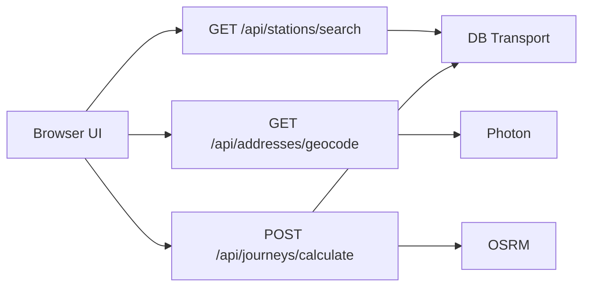

# Architecture

## Request flow

The browser UI is the React app in `client/`; it never calls providers directly, only the `/api` routes (`client/src/lib/api-client.ts`). Pages Functions under `functions/api/` validate HTTP input and delegate to services in `src/services/`. Provider adapters in `src/clients/` isolate DB Transport, OSRM, and Photon formats. The frontend renders loading, no-route, partial-result, stale, delay, and validation-failure states; preserve entered values whenever a request fails.

The UI geocodes home and work addresses once when settings are saved (re-geocoding only changed addresses) and stores the coordinates with the profile. Each dashboard load posts the profile to `/api/journeys/calculate` with `results: 5`; every returned option becomes one journey card.

### API contracts

| Endpoint | Input | Result |
| --- | --- | --- |
| `GET /api/stations/search` | `query` (2–100 chars), optional `limit` (1–20; default 5) | DB Transport station matches. |
| `GET /api/addresses/geocode` | non-empty `q`, optional `limit` (1–10; default 5) | Photon address candidates and coordinates. |
| `POST /api/journeys/calculate` | home/work station IDs, home/work coordinates, `direction` (`work` or `home`), `departureTime` and/or `arrivalTime` (ISO; departure wins when both are sent), optional minute buffers, optional `results` (1–6, default 1), optional `excludeLongDistance` | `options[]` (one canonical journey per connection, plus `lineName` and `transfers`) and `calculatedJourneys` holding the first option. |

All endpoints use `{ "success": true, "data": ... }` on success and `{ "success": false, "error": { "code", "message", "details" } }` on failure. Validate external data before presenting it; a missing canonical field is an upstream-bad-response error, not an invitation to invent an alias.

## Journey model and contracts

The fixed journey is `A → B → C → D`:

- `A`: `homeAddress`; `B`: `homeStation`; `C`: `workStation`; `D`: `workAddress`.
- `x` is the home address/station route, `y` is station-to-station public transport, and `z` is the work station/address route.
- `journeyWork` travels A→D; `journeyHome` travels D→A. Segment `y` is named `transportWork` or `transportHome` to match direction.
- `homeStationTime` and `workStationTime` are immutable station-time anchors. `routeHomeWalkSec`, `routeHomeBikeSec`, `routeWorkWalkSec`, and `routeWorkBikeSec` are durations in seconds.
- Buffers enter as non-negative minutes and are converted to seconds. The canonical outputs are `homeAddressWalkTime`, `homeAddressBikeTime`, `workAddressWalkTime`, and `workAddressBikeTime`, all ISO 8601 timestamps.

For `journeyWork`, subtract the home-station, home-route, preparation, and leave-home buffers from `homeStationTime`; add the work-station buffer and work-route duration to `workStationTime`. For `journeyHome`, add the home-station buffer and home-route duration to `homeStationTime`; subtract the work-station, work-route, preparation, and leave-work buffers from `workStationTime`. The implementations and runtime validation live in `src/models/canonicalJourney.ts`.

## Providers and resilience

| Provider | Responsibility | Failure policy |
| --- | --- | --- |
| DB Transport | Canonical timing for segment `y` and station search. | Fail closed: never fabricate station anchors. A clearly labeled stale result may be used for up to 10 minutes. |
| OSRM | Walk/bike duration and distance for `x` and `z`. | Fail open: use a bounded cached or estimated duration and label it stale/estimated. |
| Photon | Address query to coordinates. | Existing saved coordinates may continue to work; a new unresolved address requires retry/correction. |

Use request deduplication, debounce address searches by 300–500 ms, and honor the stricter of provider terms and project caps. Default per-session caps are DB 1 request/sec (3 per 5 sec burst), OSRM 2/sec (6 per 5 sec), and Photon 1/sec while typing (5 per 10 sec). Provider attribution belongs in relevant results and the About/Legal surface. Outbound requests use the descriptive User-Agent configured in `src/clients/providerCompliance.ts`; do not spoof browser headers. Public OSRM is for light/testing use, so production traffic needs a compliant hosted or self-hosted option.

## Browser storage

The React UI stores its profile (addresses with coordinates, stations, buffers, language, long-distance filter) under `pendelpilot.settings.v1` (`client/src/lib/settings-storage.ts`).

The backend model also defines a richer versioned store under `dailyjourney.v2.*` (`src/models/localPersistence.ts`, used by the view models in `src/frontend/`), which the React UI does not use yet:

- `commuteProfiles`, selected station/address snapshots, and buffer presets restore the user’s setup.
- Persisted canonical journeys and DB Transport, Photon, and OSRM cache envelopes provide bounded fallback behavior.
- OSRM stores duration-only walk/bike data—not route geometry, instructions, or full upstream responses.

Invalidate cache when addresses, stations, direction, buffer/routing assumptions, or the cache-key version changes; a manual refresh bypasses the relevant TTL. DB cache is short-lived (about 60–120 seconds), Photon cache is 7–30 days, and OSRM durations default to 14 days with a maximum 30-day stale window. The precise types, keys, validation, migration, and invalidation logic are in `src/models/localPersistence.ts`.

## Operations

Cloudflare Pages serves `dist/` (the built UI) and maps `functions/api/**` to API routes. Keep `wrangler.toml` aligned with the Pages project; it pins the project name, output directory, and compatibility date. CI and the production workflow run `npm run check` before deployment. For a timeout, identify the provider, check its rate/status, confirm the permitted cache fallback, then lower request rates or disable high-volume features if necessary. For a policy change, verify the provider’s published terms, update code/configuration and attribution, and restrict non-compliant behavior until fixed.
